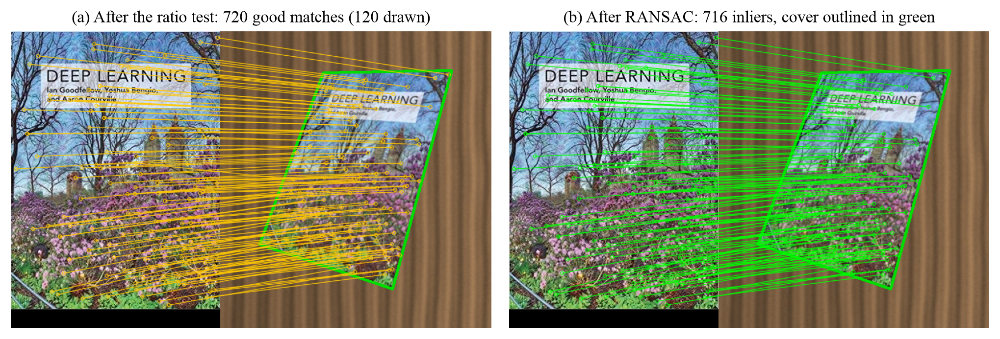
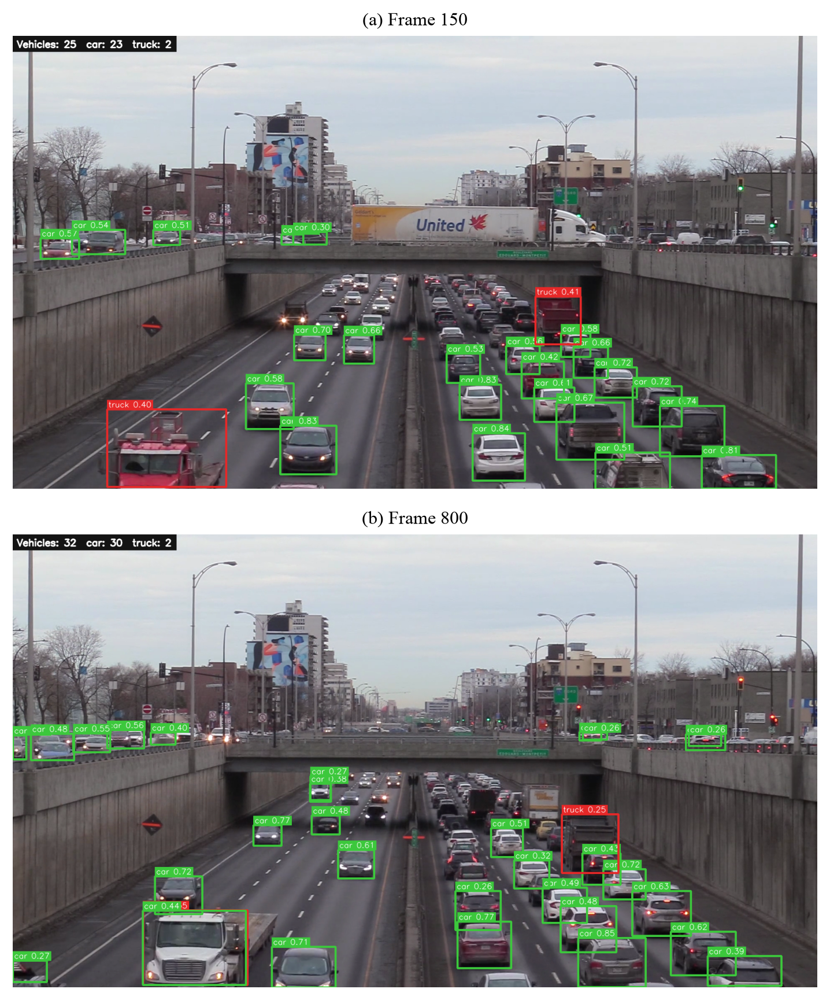

# Advanced Computer Vision Case Studies

This repository holds the code and figures for two computer vision case studies: recognizing book covers with SIFT feature matching, and detecting vehicles in traffic video with YOLOv8.

## Case Study 1: Book cover recognition

`code/book_matcher.py` decides whether two images show the same book. It needs no training, and adding a book takes one reference image.

1. Detect SIFT keypoints and compute their descriptors.
2. Find each keypoint's two nearest neighbours, then filter the matches with Lowe's ratio test (0.75).
3. Fit a homography with RANSAC, using a 5 px reprojection threshold.
4. Report "same book" if there are at least 15 inliers.



Example output on one matching pair and one non-matching pair:

| Query | Good matches | RANSAC inliers | Decision |
|-------|--------------|----------------|----------|
| Same book | 720 | 716 | Same book |
| Different book | 3 | 0 | Different book |

The experiments use seven covers and simulated query photos. Each cover is warped onto a textured tabletop with varied pose, lighting, noise and JPEG compression. Because the true homography is known, localization error can be measured exactly.

## Case Study 2: Vehicle detection

`code/vehicle_detector.py` runs a COCO-pretrained YOLOv8 model on a video. It detects bicycles, cars, motorcycles, buses and trucks, then writes an annotated video with bounding boxes, class labels and live counts.



Example CPU runs with the default model:

| Video | Frames | Inference | Mean vehicles per frame |
|-------|--------|-----------|-------------------------|
| Urban (dense) | 300 | 59.3 ms/frame (16.9 FPS) | 30.88 |
| Highway (sparse) | 200 | 65.1 ms/frame (15.4 FPS) | 3.77 |

The videos have no annotated ground truth. The experiments compare results against a reference built from YOLOv8x on overlapping high-resolution tiles, which was checked by eye on a sample of frames. These numbers measure agreement with that reference and are not a published mAP.

## Getting started

```bash
git clone https://github.com/SurajsinghBayas/advanced-computer-vision-case-studies.git
cd advanced-computer-vision-case-studies
python -m venv .venv
source .venv/bin/activate
pip install -r code/requirements.txt
```

Compare two images:

```bash
python code/book_matcher.py reference.jpg query.jpg --out matches.png
```

Detect vehicles in a video:

```bash
python code/vehicle_detector.py traffic.mp4 --model yolov8n.pt --out output.mp4
```

`vehicle_detector.py` also accepts `--conf`, `--imgsz`, `--device` and `--max-frames`.

## Reproducing the experiments

The input data, model weights and results are not in this repository, so add them first. The scripts expect this layout:

```
<cv_dir>/
├── code/      # this repository's code/ folder
├── data/      # cover_<ISBN>.jpg, vehicles.mp4, vehicles-2.mp4
├── models/    # yolov8n.pt, yolov8s.pt, yolov8x.pt
├── outputs/   # created by the experiments
└── figures/   # created by the figure scripts
```

The cover filenames must match the ISBNs listed in `TITLES` in `code/experiments_cs1.py`.

Run these from `<cv_dir>`:

```bash
python code/experiments_cs1.py data outputs/cs1
python code/experiments_cs2.py data models outputs/cs2
python code/make_figures.py .
```

## Repository contents

| Path | Contents |
|------|----------|
| `code/book_matcher.py` | Case Study 1 command-line tool |
| `code/vehicle_detector.py` | Case Study 2 command-line tool |
| `code/experiments_cs1.py`, `code/experiments_cs2.py` | Experiments that produce the results JSON files |
| `code/make_figures.py`, `code/make_figures_short.py` | Report figures |
| `code/audit.py` | Montages of detection disagreements for checking by eye |
| `code/shots.py` | Code and terminal screenshots (uses a macOS font path) |
| `code/compress_figures.py` | JPEG versions of the photo figures |
| `code/build_report.py`, `code/build_short.py` | Word report generators |
| `figures/` | Generated figures |
